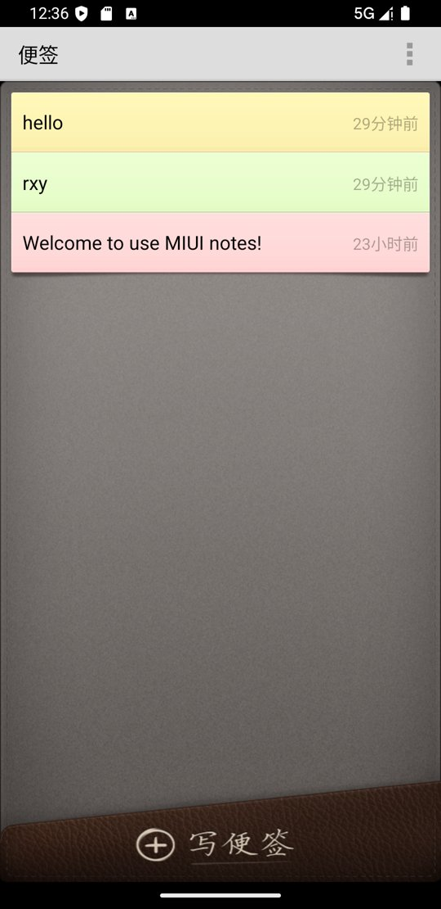

# 小米便签 · Android Studio 现代化维护版

> 基于 [MiCode/Notes](https://github.com/MiCode/Notes) 的小米便签开源版，已完成 Android Studio / Gradle 工程化改造，并持续进行功能完善、缺陷修复与新系统适配。

-3DDC84?logo=android&logoColor=white)


## 项目简介

本项目是小米便签（MiCode Notes）的社区维护版本。原项目是 Eclipse ADT 工程，无法直接在现代 Android Studio 中编译运行。本仓库完成了从 Eclipse 到 Android Studio / Gradle 的迁移，并修复了在新版本 Android 系统上会导致编译失败或运行崩溃的问题。

项目目标：

- **可运行**：使用当前主流 Android Studio、JDK 17、Android SDK 34 直接打开、同步、编译和运行。
- **可维护**：统一工程结构、构建脚本和代码注释，降低后续维护成本。
- **持续完善**：逐步修复历史缺陷，补充新功能，跟进 Android 新版本行为变更。
- **开放协作**：通过 GitHub Issue 和 Pull Request 持续接收问题反馈与改进建议。

## 运行截图



## 已完成适配

| 项目 | 改造前 | 改造后 |
|---|---|---|
| 工程结构 | Eclipse ADT（根目录 `src` / `res`） | Android Studio 标准 `app/src/main` |
| 构建方式 | Ant / Eclipse | Gradle 8.6 + AGP 8.4.2 |
| 编译 SDK | 旧版 SDK | `compileSdk 34` |
| 目标 SDK | 旧版 target | `targetSdk 34` |
| 最低版本 | `minSdk 14` | `minSdk 21` |
| JDK | 旧版 JDK | JDK 17 |
| 依赖 | Eclipse 工程依赖 | 仅框架 API，无第三方运行时依赖 |

### 兼容性修复

- 将 R 资源 ID 设为 final，修复 `switch (R.id...)` 在新版 AGP 下的编译错误。
- 为 Google Tasks 同步模块补充 `org.apache.http.legacy` 支持。
- 为 Android 12+ 的组件补充 `android:exported` 声明。
- 为 `PendingIntent` 增加 `FLAG_IMMUTABLE`，修复 Android 12+ 崩溃。
- 适配 Android 14 动态广播接收器的 `RECEIVER_NOT_EXPORTED` 参数。
- 使用 `Notification.Builder` + NotificationChannel 替换已删除的 `setLatestEventInfo()`。
- 同步广播增加 `setPackage()`，避免隐式广播安全问题。
- 清理未使用方法、过期注释和注释掉的旧代码，并补充中文分层注释。

## 当前可用功能

> 以下仅列出当前版本在界面中可以实际操作并已验证的功能，按实际可用范围维护。

- 便签列表展示
- 新建便签
- 打开已有便签并编辑正文
- 返回时自动保存
- 批量选择、删除、移动便签（移动前需要先新建文件夹）
- 新建文件夹与文件夹浏览
- 搜索
- 设置页
- 本地 SQLite 数据库存储

## 暂不可用 / 待恢复功能

以下功能在代码中仍有实现或残留，但当前版本功能入口不可用、未完成适配或未通过验证，暂不计入可用功能：

- 通话记录文件夹管理
- 字体大小、背景颜色、清单模式
- 提醒时间设置与闹钟提醒
- 导出为文本（入口已恢复，但受 Android 10+ 存储限制，当前导出失败）
- 2x2 / 4x4 桌面小部件
- Google Tasks 同步

## 技术栈与结构

```text
Notes/
├── app/
│   ├── build.gradle.kts          # 应用模块构建脚本
│   └── src/main/
│       ├── AndroidManifest.xml
│       ├── java/net/micode/notes/
│       │   ├── data/             # 数据库、ContentProvider、联系人
│       │   ├── gtask/            # Google Tasks 同步
│       │   ├── model/            # 便签模型与编辑状态
│       │   ├── tool/             # 工具类、资源映射、备份
│       │   ├── ui/               # Activity、适配器、自定义控件
│       │   └── widget/           # 桌面小部件
│       └── res/                  # 布局、图片、字符串、菜单等资源
├── docs/                         # 项目截图
├── gradle/wrapper/               # Gradle Wrapper
├── build.gradle.kts
├── settings.gradle.kts
├── gradle.properties
└── README.md
```

- 语言：Java
- 最低版本：Android 5.0（API 21）
- 编译 / 目标版本：Android 14（API 34）
- 构建：Gradle 8.6、AGP 8.4.2
- JDK：17
- 第三方 UI 框架：无（使用系统 Holo 主题与原生控件）

## 快速开始

### 环境要求

- Android Studio 2023.3.1 或更新版本
- JDK 17
- Android SDK Platform 34
- Android SDK Build-Tools 34.0.0

### Android Studio

1. `File > Open`，选择本项目根目录。
2. 等待 Gradle Sync 完成；如未自动开始，点击 **Sync Project with Gradle Files**。
3. 连接模拟器或真机，点击 **Run 'app'**。

### 克隆仓库

```bash
git clone https://github.com/Ren-xiuyan/MiNotes-AndroidStudio.git
cd MiNotes-AndroidStudio
```

### 日常维护流程

```bash
git pull origin main                 # 同步最新代码
git checkout -b fix/issue-xxx        # 新建修复分支
# 修改并本地验证
git add .
git commit -m "fix: 描述修复内容"
git push origin fix/issue-xxx        # 推送分支，发起 Pull Request
```

### 命令行构建

Windows：

```bat
gradlew.bat assembleDebug
```

macOS / Linux：

```bash
./gradlew assembleDebug
```

生成的 APK：

```text
app/build/outputs/apk/debug/app-debug.apk
```

安装：

```bash
adb install -r app/build/outputs/apk/debug/app-debug.apk
```

> `local.properties` 保存本机 SDK 路径，已被 `.gitignore` 忽略，请勿提交。

## 当前状态与已知限制

项目已经可以正常启动、新建便签、编辑正文、返回保存和浏览列表；列表页菜单已恢复批量删除、移动、搜索和设置入口。以下功能尚未完成适配或未通过验证，后续优先恢复：

- Google Tasks 旧接口与认证方式已发生变化，现有同步客户端可能无法完成登录与同步，后续评估替换或移除。
- Android 10+ 的分区存储限制会影响导出到 SD 卡等旧文件操作。
- Android 10+ 的后台启动限制可能影响闹钟提醒界面的弹出，需要改为全屏通知等新方案。
- 旧版 Holo 主题在新系统上仍可使用，但视觉风格较旧，后续可迁移到 Material Design。

## Roadmap

### 功能入口恢复（优先）

- [x] 恢复删除、批量删除、移动便签入口
- [x] 恢复新建文件夹与文件夹浏览入口
- [ ] 恢复字体大小、背景颜色、清单模式
- [x] 恢复搜索入口
- [ ] 恢复提醒时间设置与闹钟提醒
- [ ] 完成文本导出适配（入口已恢复，当前导出失败）
- [ ] 恢复 2x2 / 4x4 桌面小部件
- [x] 恢复设置页入口
- [ ] 恢复 Google Tasks 同步

### 功能完善

- [ ] 用 Storage Access Framework 重做文本导出
- [ ] 用通知 + 全屏 Intent 重做提醒
- [ ] 评估移除或替换已停止服务的 Google Tasks 同步
- [ ] 增加便签排序、置顶、标签等实用功能
- [ ] 适配深色模式与 Material Design

### 缺陷修复

- [ ] 建立 Issue 模板，按“复现步骤 / 预期结果 / 实际结果”跟踪问题
- [ ] 补充关键路径的单元测试和仪器测试
- [ ] 修复历史代码中的边界条件和空指针风险

### 工程质量

- [ ] 接入 GitHub Actions 自动构建
- [ ] 统一代码风格与静态检查
- [ ] 持续补充中文注释和架构文档
- [ ] 定期跟进 Android SDK / AGP / Gradle 升级

## 贡献指南

欢迎提交 Issue 和 Pull Request：

1. 先搜索已有 Issue，避免重复。
2. Bug 反馈请提供设备/系统版本、复现步骤、日志和截图。
3. 功能建议请说明使用场景和预期效果。
4. 提交代码前请确保 `gradlew build` 通过。
5. 一个 Pull Request 尽量只解决一个问题，便于审查。

更详细的说明见 [CONTRIBUTING.md](CONTRIBUTING.md)。

## 开源协议与致谢

本项目基于 [MiCode/Notes](https://github.com/MiCode/Notes) 的 `master` 分支（上游最后同步提交：`81a6602`）修改，遵循 Apache License 2.0，详见 [LICENSE](LICENSE) 与 [NOTICE](NOTICE)。

感谢 MIUI 团队和 MiCode 社区为小米便签开源版做出的贡献。

> 本项目为社区维护版本，与原小米公司/MIUI 官方无隶属关系。
